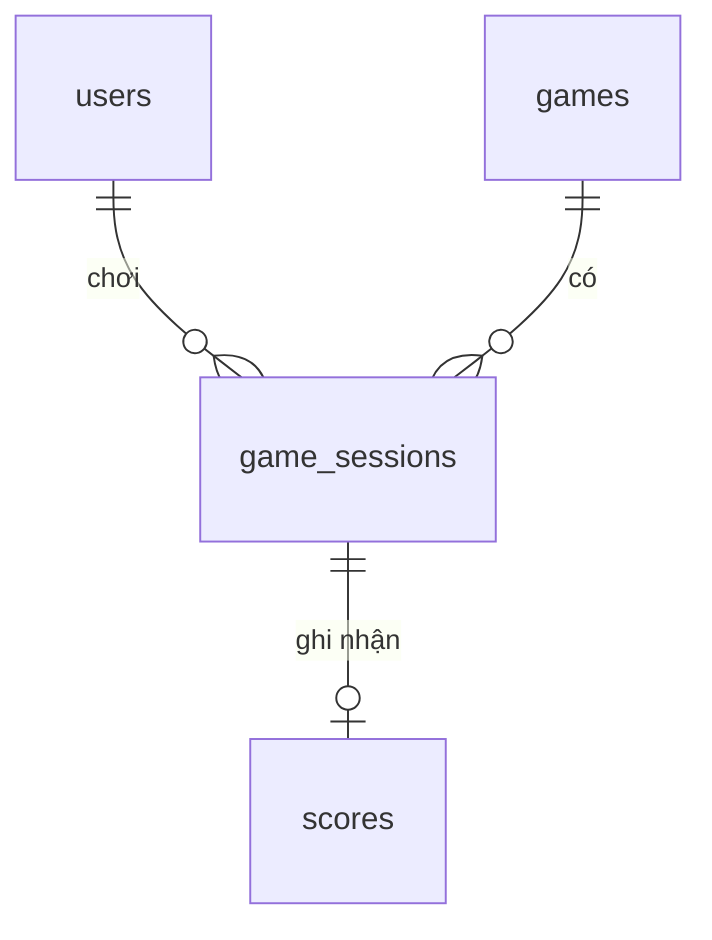

# Thiết kế Tuần 1

Flutter gọi Express bằng HTTP. Express và Socket.IO dùng chung HTTP server. MySQL lưu tài khoản, danh mục trò chơi, phiên chơi và điểm. API đang triển khai ở Tuần 1 gồm `GET /health`.

## ERD

| Bảng | Trách nhiệm |
| --- | --- |
| `users` | Tài khoản với username và email duy nhất, hash mật khẩu và thông tin hồ sơ. |
| `games` | Danh mục gồm Rubik, Sudoku, Xếp hình và Caro. |
| `game_sessions` | Theo dõi người chơi, trò chơi, độ khó, seed và thời gian phiên do server quản lý. |
| `scores` | Kết quả tính điểm của phiên đã hoàn thành. Mỗi phiên có tối đa một kết quả. |

Khóa ngoại của `scores` ràng buộc người chơi, trò chơi và độ khó với phiên tương ứng. Chỉ mục xếp theo điểm giảm dần, thời gian tăng dần và ID phiên để phân định các kết quả đồng điểm. Khi triển khai nộp bài, server sẽ ghi kết quả và hoàn thành phiên trong cùng một giao dịch. Các bảng thách đấu, ELO và chat sẽ được thiết kế khi triển khai các tính năng đó.

## API

| Phương thức | Đường dẫn | Mục đích | Trạng thái |
| --- | --- | --- | --- |
| GET | `/health` | Kiểm tra tiến trình HTTP | Tuần 1 |
| POST | `/api/auth/register` | Tạo tài khoản | Dự kiến |
| POST | `/api/auth/login` | Đăng nhập, trả JWT | Dự kiến |
| GET | `/api/auth/me` | Lấy hồ sơ của người đăng nhập | Dự kiến |
| POST | `/api/games/sudoku/new`, `/api/games/puzzle/new` | Tạo phiên chơi theo độ khó | Dự kiến |
| POST | `/api/games/sudoku/submit`, `/api/games/puzzle/submit`, `/api/games/caro/submit` | Nộp lượt chơi để server xác minh và tính điểm | Dự kiến |
| POST | `/api/games/rubik/solve` | Nhận trạng thái 54 sticker, trả nước giải | Dự kiến |
| GET | `/api/scores/me` | Tra lịch sử điểm cá nhân | Dự kiến |
| GET | `/api/leaderboard?game=&difficulty=&period=` | Bảng xếp hạng theo trò chơi, độ khó và kỳ | Dự kiến |
| POST | `/api/matches`, `/api/matches/:id/accept` | Tạo và chấp nhận lời thách đấu | Mở rộng |
| GET | `/api/chat/history?with=` | Lịch sử chat | Mở rộng |
| POST | `/api/ai/coach` | Giải thích gợi ý | Mở rộng |

API nghiệp vụ dự kiến yêu cầu `Authorization: Bearer <token>` ngoài đăng ký và đăng nhập. Lỗi trả JSON với trường `error` và mã trạng thái HTTP tương ứng.

Các nhóm sự kiện Socket.IO dự kiến gồm `chat:send`, `chat:receive`, `match:invite`, `match:start`, `match:progress`, `match:finish` và `match:result`.
